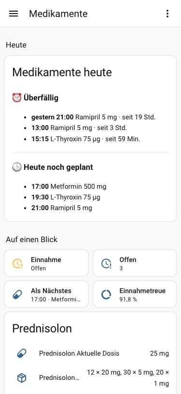
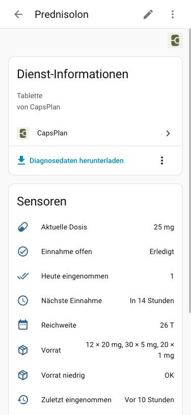
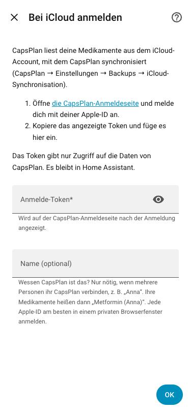
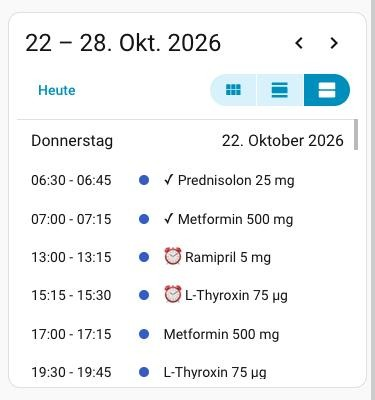

<p align="center">
  
</p>

<h1 align="center">CapsPlan für Home Assistant</h1>

<p align="center">
  Deine Medikamente aus <a href="https://apps.apple.com/app/id6779642344"><b>CapsPlan</b></a> in Home Assistant:<br>
  nächste Einnahme, offene Einnahmen, Vorrat, Reichweite und Ausschleich-Dosis – direkt aus deiner eigenen iCloud.
</p>

<p align="center"><a href="README.md">🇬🇧 English</a></p>

---

**CapsPlan** ist eine Medikamenten-Erinnerung für iPhone, iPad und Apple Watch (und Android): Einnahmen mit Erinnerungen, Einnahmeverlauf, Vorrat pro Tablettenstärke, Ein- und Ausschleichpläne, Live-Aktivitäten und Widgets. Seit Version 1.15 kann CapsPlan deine Daten über iCloud zwischen deinen Apple-Geräten synchronisieren. Diese Integration liest genau diese Daten – Home Assistant weiß damit immer, was CapsPlan weiß.

- ✅ **Kostenlos und Open Source** (MIT). Kein Konto bei uns, kein Server von uns, kein Tracking.
- 🔒 **Deine Daten bleiben deine**: Home Assistant liest sie direkt aus *deiner* iCloud. Nichts läuft über Dritte.
- 👀 **Nur lesend**: Die Integration verändert nie etwas an deinen Daten in CapsPlan.

<p align="center">
  
  &nbsp;
  
  &nbsp;
  
</p>
<p align="center"><sub>Demo-Daten. Links die <a href="#übersicht-erst-überfälliges-dann-der-rest-von-heute">Übersichtskarte</a> mit Kacheln, Mitte ein Medikament mit seinen Sensoren, rechts die Einrichtung.</sub></p>

## Was du bekommst

Jedes Medikament wird ein eigenes Gerät in Home Assistant (Entitäts-IDs mit deutscher Sprache):

| Entität | Beispiel | Hinweise |
|---|---|---|
| `sensor.<medikament>_nachste_einnahme` | heute 19:00 | Zeitpunkt; Attribute `dose`, `unit` |
| `sensor.<medikament>_heute_eingenommen` | `1` | Attribute `planned`, `open`, `skipped` und die Liste `doses` von heute |
| `binary_sensor.<medikament>_einnahme_offen` | an | Eine Einnahme ist fällig und weder bestätigt noch übersprungen |
| `sensor.<medikament>_zuletzt_eingenommen` | heute 07:05 | Zeitpunkt der letzten Bestätigung |
| `sensor.<medikament>_aktuelle_dosis` | `8 mg` | Dosis von heute, folgt Ausschleichplänen |
| `sensor.<medikament>_vorrat` | `94 × 75 mg, ½ × 50 mg` | Tabletten pro Stärke; Attribute `tablets_by_strength`, `total` (in der Dosiseinheit) |
| `sensor.<medikament>_reichweite` | `29 d` | Wie viele Tage der Vorrat mit den geplanten Einnahmen reicht, Ausschleichen eingerechnet (max. 365) |
| `binary_sensor.<medikament>_vorrat_niedrig` | aus | Deine Vorratswarnung aus CapsPlan |

Dazu ein Gerät **CapsPlan** für alles zusammen:

| Entität | Zeigt |
|---|---|
| `sensor.capsplan_offene_einnahmen` | **Alle offenen Einnahmen**, z. B. `05:30 Metformin 500 mg, 12:00 Ramipril 5 mg` (`–`, wenn keine) |
| `sensor.capsplan_heute_noch` | **Alles, was heute noch zu nehmen ist**, Überfälliges mit ⏰, z. B. `⏰ 12:00 Ramipril 5 mg, 20:00 Metformin 500 mg` |
| `sensor.capsplan_als_nachstes` | Die Einnahmen zur nächsten Zeit, z. B. `16:00 · Metformin 500 mg, Ramipril 5 mg` |
| `calendar.capsplan_einnahmen` | Alle geplanten Einnahmen als Kalendertermine: ✓ genommen, ✗ übersprungen, ⏰ offen |
| `sensor.capsplan_anzahl_offen` | Anzahl offener Einnahmen (für Automationen) |
| `binary_sensor.capsplan_einnahme_offen` | *Offen*, solange irgendeine Einnahme offen ist, sonst *Erledigt* |
| `sensor.capsplan_nachste_einnahme` | Zeitpunkt der nächsten Einnahme (für Automationen); Attribut `medications` |
| `sensor.capsplan_einnahmetreue_7_tage` | Anteil der geplanten Einnahmen der letzten 7 Tage, die genommen wurden |
| `sensor.capsplan_letzte_synchronisation` | Diagnose: letzter erfolgreicher Abgleich mit iCloud |

Die Listen-Sensoren enthalten die Einnahmen zusätzlich als Attribut `doses` (Medikament, Zeit, Dosis, Einheit, Status) und `count`.

Gut zu wissen:

- **Einnahmen von gestern**, die weder bestätigt noch übersprungen wurden, bleiben bis zum Ende des Folgetags *offen* – genau wie CapsPlan sie zeigt („von gestern“); in den Listen stehen sie mit Datum.
- **Pausierte oder abgeschlossene Medikamente** (in CapsPlan ausgeschaltet) werden nicht angezeigt, **gelöschte Medikamente** verschwinden automatisch. Wieder eingeschaltet, kommen sie zurück.
- **Namen** folgen der Sprache von Home Assistant – Deutsch, Englisch, Spanisch, Italienisch und Türkisch wie die App – und damit auch die Entitäts-IDs: auf Englisch heißt `sensor.metformin_reichweite` `sensor.metformin_supply`.
- Bedarfsmedikamente bekommen nur die Entitäten, die für sie sinnvoll sind.
- Medikamentennamen lieber nicht zeigen? **Medikamentennamen ausblenden** einschalten (siehe [Datenschutz und Sicherheit](#datenschutz-und-sicherheit)).

## Voraussetzungen

- **CapsPlan 1.15 oder neuer** auf iPhone oder iPad mit eingeschalteter **iCloud-Synchronisation**: CapsPlan → Einstellungen → Backups → *iCloud-Synchronisation*.
- **Home Assistant 2026.3** oder neuer.
- Eine Apple-ID **ohne erweiterten Datenschutz für iCloud**, siehe [Einschränkungen](#einschränkungen).

> Die iCloud-Synchronisation von CapsPlan gibt es derzeit auf iPhone und iPad. Für Android ist ein Gegenstück in Arbeit.

## Installation

### Mit HACS (empfohlen)

1. HACS öffnen → ⋮ (oben rechts) → **Benutzerdefinierte Repositories**.
2. Repository: `https://github.com/DXdotM/capsplan-home-assistant`, Typ **Integration** → **Hinzufügen**.
3. In HACS nach **CapsPlan** suchen, öffnen und **Herunterladen**.
4. Home Assistant neu starten.

[](https://my.home-assistant.io/redirect/hacs_repository/?owner=DXdotM&repository=capsplan-home-assistant&category=integration)

### Von Hand

Den Ordner `custom_components/capsplan` aus dem [neuesten Release](https://github.com/DXdotM/capsplan-home-assistant/releases) in den Ordner `custom_components` deiner Home-Assistant-Konfiguration kopieren und Home Assistant neu starten.

## Einrichtung

[](https://my.home-assistant.io/redirect/config_flow_start/?domain=capsplan)

1. Einstellungen → Geräte & Dienste → **Integration hinzufügen** → **CapsPlan**.
2. Die **[CapsPlan-Anmeldeseite](https://dxdotm.github.io/capsplan-home-assistant/)** öffnen und auf *Mit Apple-ID anmelden* klicken.
3. Mit der Apple-ID anmelden, mit der CapsPlan synchronisiert. (Bietet Apple *Angemeldet bleiben* an, den Haken setzen.)
4. Apple leitet zurück auf die Seite, die jetzt dein **Anmelde-Token** zeigt. Kopieren.
5. Gleich danach in den Einrichtungsdialog in Home Assistant einfügen und absenden.

Fertig – deine Medikamente erscheinen nach wenigen Sekunden als Geräte.

**Warum ein Token?** Apple lässt Apps nur dann an deine iCloud-Daten, wenn du dich auf Apples eigener Seite angemeldet hast. Die Anmeldeseite ist eine kleine statische Seite in diesem Repository (siehe [`docs/index.html`](docs/index.html)): Sie spricht nur mit Apple und zeigt das Token in deinem Browser an; es wird nirgendwohin sonst geschickt. Das Token gibt Zugriff auf die Daten von CapsPlan in deiner iCloud – nicht auf Fotos, Mails oder irgendetwas anderes.

## Mehrere Personen

Jede Person verbindet ihr eigenes CapsPlan (ihre eigene Apple-ID) als eigenen Eintrag:

1. Einstellungen → Geräte & Dienste → **Integration hinzufügen** → **CapsPlan** – einmal pro Person.
2. Auf der Anmeldeseite mit der Apple-ID dieser Person anmelden – am besten in einem **privaten Browserfenster**, sonst meldet Apple womöglich automatisch wieder die vorherige Apple-ID an.
3. Bei der Einrichtung einen **Namen** eingeben, z. B. `Anna`.

Mit Namen ist alles unterscheidbar: Das Gerät heißt *CapsPlan Anna* (`sensor.capsplan_anna_heute_noch`), Medikamente heißen *Metformin (Anna)* (`sensor.metformin_anna_nachste_einnahme`). Die [Übersichtskarte](#übersicht-erst-überfälliges-dann-der-rest-von-heute) sammelt alle Personen automatisch ein und schreibt den Namen hinter jede Einnahme.

Der Name lässt sich später ändern: Geräte & Dienste → CapsPlan → Eintrag → ⚙️ **Konfigurieren**. Bestehende Entitäts-IDs bleiben gleich.

## Beispiele

### Licht zeigt eine offene Einnahme

```yaml
automation:
  - alias: "Medikamente: Licht zeigt offene Einnahme"
    triggers:
      - trigger: state
        entity_id: binary_sensor.capsplan_einnahme_offen
    actions:
      - choose:
          - conditions: "{{ trigger.to_state.state == 'on' }}"
            sequence:
              - action: light.turn_on
                target: { entity_id: light.kueche }
                data: { color_name: red, brightness_pct: 60 }
        default:
          - action: light.turn_off
            target: { entity_id: light.kueche }
```

### Familie erinnern, wenn eine Einnahme 30 Minuten überfällig ist

```yaml
automation:
  - alias: "Medikamente: überfällig"
    triggers:
      - trigger: state
        entity_id: binary_sensor.capsplan_einnahme_offen
        to: "on"
        for: "00:30:00"
    actions:
      - action: notify.familie
        data:
          title: "Medikamente"
          message: >
            Noch offen:
            
            {{ d.medication }} ({{ as_datetime(d.time).strftime('%H:%M') }}){{ ', ' if not loop.last }}
            
```

### Rechtzeitig nachbestellen: Reichweite unter 10 Tagen

```yaml
automation:
  - alias: "Medikamente: nachbestellen"
    triggers:
      - trigger: numeric_state
        entity_id: sensor.metformin_reichweite
        below: 10
    actions:
      - action: todo.add_item
        target: { entity_id: todo.einkaufsliste }
        data: { item: "Rezept Metformin" }
```

### Übersicht: erst Überfälliges, dann der Rest von heute

```
### ⏰ Überfällig
- gestern 21:00  Ramipril 5 mg · seit 19 Std.
- 12:00  Metformin 500 mg · seit 1 Std.
───────────────
### 🕒 Heute noch geplant
- 16:00  Metformin 500 mg
- 19:00  Ramipril 5 mg
```

Dashboard → Bearbeiten → Karte hinzufügen → *Manuell*, einfügen ([`examples/overview-card.de.yaml`](examples/overview-card.de.yaml)):

```yaml
type: markdown
title: Medikamente heute
content: |
  
  
  
  
  
  
  
  
  ### ⏰ Überfällig
  
  
  - **gestern {{ as_datetime(d.time).strftime('%H:%M') }}** {{ d.medication }} {{ '%g' | format(d.dose) }} {{ d.unit }} ({{ d.person }}) · seit {{ m // 60 }} Std.seit {{ m }} Min.
  
  ✓ Nichts überfällig
  

  ---

  ### 🕒 Heute noch geplant
  
  - **{{ as_datetime(d.time).strftime('%H:%M') }}** {{ d.medication }} {{ '%g' | format(d.dose) }} {{ d.unit }} ({{ d.person }})
  
  ✓ Für heute ist nichts mehr geplant
  
```

### Weitere Dashboard-Karten

Alles als Text, ohne Graphen – eine Markdown-Karte:

```yaml
type: markdown
title: Medikamente
content: >-
  **Offen:** {{ states('sensor.capsplan_offene_einnahmen') }}

  **Heute noch:** {{ states('sensor.capsplan_heute_noch') }}

  **Als Nächstes:** {{ states('sensor.capsplan_als_nachstes') }}
```

Oder als Kacheln – je eine Zeile, gut für Wand-Tablets:

```yaml
type: grid
columns: 2
square: false
cards:
  - type: tile
    entity: binary_sensor.capsplan_einnahme_offen
    name: Einnahme
  - type: tile
    entity: sensor.capsplan_anzahl_offen
    name: Offen
  - type: tile
    entity: sensor.capsplan_als_nachstes
    name: Als Nächstes
  - type: tile
    entity: sensor.capsplan_einnahmetreue_7_tage
    name: Einnahmetreue
```

Der Tag auf einen Blick – jede Einnahme mit ✓ / ✗ / ⏰:



```yaml
type: calendar
entities:
  - calendar.capsplan_einnahmen
initial_view: listWeek
```

Weitere Beispiele (Durchsage vor der Einnahme, Vorratswarnung, Ausschleich-Dosis ändert sich): [`examples/automations.yaml`](examples/automations.yaml).

## So funktioniert es

- CapsPlan speichert jedes Medikament, jede Einnahme, Stärke und Ausschleich-Phase als Datensatz in einer privaten iCloud-Zone deiner Apple-ID. Home Assistant holt **alle 5 Minuten** die Änderungen (nur was sich seit dem letzten Mal geändert hat) und hält eine lokale Kopie, damit ein Neustart nicht alles neu lädt.
- Geplante Einnahmen werden **berechnet**, genau wie in der App: Uhrzeiten, Wochentage, Intervalle (alle n Tage), eigene Zeiten pro Wochentag und Ausschleichpläne mit Dosis pro Einnahmezeit. Zustände wie *offen* oder *nächste Einnahme* werden jede Minute aktualisiert.
- Das Token wird mit jeder Anfrage erneuert und in Home Assistant gespeichert. Solange Home Assistant läuft, bleibt die Anmeldung normalerweise gültig. Läuft sie doch ab, zeigt Home Assistant einen **Reparaturhinweis**: einmal auf der Anmeldeseite neu anmelden und das neue Token einfügen.

## Einschränkungen

- **Erweiterter Datenschutz für iCloud**: Apple gibt Accounts mit erweitertem Datenschutz keine Web-Anmeldung für App-Daten in iCloud. Ist er eingeschaltet, schlägt die Anmeldung auf der Anmeldeseite fehl. Die Synchronisation von CapsPlan zwischen deinen Geräten ist davon nicht betroffen.
- **Nur lesend**: Einnahmen aus Home Assistant bestätigen geht (noch) nicht.
- **Verzögerung**: Änderungen erscheinen, sobald CapsPlan sie mit iCloud abgeglichen hat und der nächste Abruf lief – meist innerhalb weniger Minuten.
- **Berechnet, nicht kopiert**: Zeigt die Integration bei einem ungewöhnlichen Einnahmeplan etwas anderes als die App, bitte ein [Issue öffnen](https://github.com/DXdotM/capsplan-home-assistant/issues).

## Datenschutz und Sicherheit

**Wie die Daten laufen.** Home Assistant spricht nur mit Apple (`api.apple-cloudkit.com`, HTTPS). Es gibt keinen Server von uns oder Dritten dazwischen, keine Analyse, keine Telemetrie. Apple trennt die Daten jeder Apple-ID: Die Integration sieht immer nur die CapsPlan-Daten der Apple-ID, die sich angemeldet hat.

**Die Tokens.**
- Der *API-Token* im Code ist absichtlich öffentlich. Er benennt nur den iCloud-Container von CapsPlan und gibt allein keinen Zugriff auf Daten.
- Das *Anmelde-Token* gilt nur für die Daten von CapsPlan – nicht für Fotos, Mails oder andere iCloud-Daten. Apple ersetzt es bei jeder Anfrage, ein altes ist wertlos.
- Es ist **nicht nur zum Lesen**: Wer dein aktuelles Token hätte, könnte auch CapsPlan-Daten in deiner iCloud ändern. Die Integration selbst liest nur. Behandle Home Assistant wie den Ort, an dem deine Passwörter liegen (siehe unten).
- Das Token landet nie in Protokollen oder Diagnosen; Fehlermeldungen werden von allem bereinigt, was es enthalten könnte.

**Die Anmeldeseite** ist eine statische Seite in diesem Repository ([`docs/index.html`](docs/index.html)). Ihre Content Security Policy erlaubt nur Verbindungen zu Apple, sie sendet keinen Referrer, lädt nichts von anderen Servern und entfernt das Token sofort aus der Adresszeile. Apple übergibt das Token in der Seitenadresse, daher taucht es kurz in den Zugriffsprotokollen von GitHub Pages auf – es verfällt, sobald Home Assistant es benutzt.

**In Home Assistant.** Token und eine lokale Kopie deiner CapsPlan-Daten liegen in `.storage/`, wie die Zugangsdaten jeder Integration. Die lokale Kopie wird gelöscht, wenn du die Integration entfernst. Empfehlungen:

- **Backups** von Home Assistant **verschlüsselt** lassen (Standard).
- Medikamentendaten sind Gesundheitsdaten. CapsPlan-Entitäten nicht für Sprachassistenten oder Alexa/Google freigeben, wenn andere sie fragen können.
- Für Dashboards, die andere sehen, **Medikamentennamen ausblenden** (⚙️ Konfigurieren) – dann steht überall „Medikament 1“, „Medikament 2“ …
- Optional den Verlauf aus dem Recorder heraushalten (die Konto-Entitäten plus eine Zeile pro Medikament):

  ```yaml
  recorder:
    exclude:
      entity_globs:
        - "*.capsplan_*"
        - "*.metformin_*"
  ```

- Diagnose-Downloads enthalten nur Anzahlen und Zustände – keine Medikamentennamen, keine Dosen, kein Token.
- Zugriff beenden: die Integration löschen. Das gespeicherte Token wird dabei mit gelöscht und nie wieder verwendet.

## Fehlerbehebung

| Problem | Lösung |
|---|---|
| Einrichtung meldet *Token nicht gültig* | Tokens gelten nur einmal. Auf der Anmeldeseite neu anmelden und das neue Token sofort einfügen. |
| Anmeldeseite zeigt kein Token | Pop-ups und Cookies für die Seite erlauben oder einen anderen Browser versuchen. Mit erweitertem Datenschutz schlägt die Anmeldung fehl (siehe oben). |
| Keine Medikamente sichtbar | Prüfen, ob in CapsPlan die iCloud-Synchronisation an ist (Einstellungen → Backups) und ob du dich mit derselben Apple-ID angemeldet hast. |
| Einnahme bleibt *offen*, obwohl genommen | CapsPlan einmal öffnen, damit es synchronisiert; den nächsten Abruf abwarten (≤ 5 Minuten). |
| Reparaturhinweis *erneut anmelden* | Die Apple-Anmeldung ist abgelaufen. Dem Hinweis folgen. |

Debug-Protokoll:

```yaml
logger:
  logs:
    custom_components.capsplan: debug
```

## Haftungsausschluss

Diese Integration ist eine Komfortfunktion und **kein Medizinprodukt**. Verlass dich für deine Medikamente immer auf CapsPlan selbst und die Anweisungen deiner Ärztin oder deines Arztes. Automationen können ausfallen (Netzwerk, iCloud, Home Assistant).

## Über CapsPlan

CapsPlan wird von DXdotM Coding entwickelt.

- App Store: <https://apps.apple.com/app/id6779642344>
- Google Play: <https://play.google.com/store/apps/details?id=com.dxdotm_coding.capsplan>
- Website: <https://dxdotm-coding.com/capsplan>
- Support: <https://dxdotm-coding.com/capsplan_support/>

## Lizenz

[MIT](LICENSE) – frei nutzbar, veränderbar und weitergebbar.
