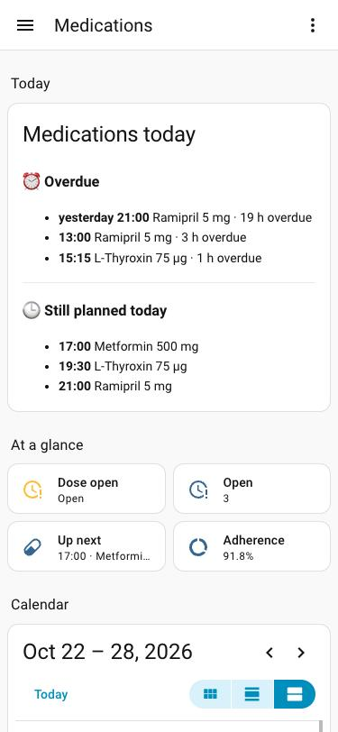
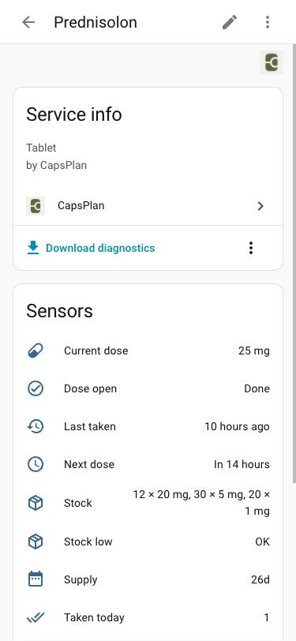

<p align="center">
  
</p>

<h1 align="center">CapsPlan for Home Assistant</h1>

<p align="center">
  Your medications from <a href="https://apps.apple.com/app/id6779642344"><b>CapsPlan</b></a> in Home Assistant:<br>
  next dose, open doses, stock, supply and tapering dose — read from your own iCloud.
</p>

<p align="center">
  <a href="https://github.com/hacs/integration"></a>
  <a href="LICENSE"></a>
  
</p>

<p align="center"><a href="README.de.md">🇩🇪 Deutsche Anleitung</a></p>

---

**CapsPlan** is a medication reminder for iPhone, iPad and Apple Watch (and Android): doses with reminders, intake history, stock per tablet strength, tapering plans, Live Activities and widgets. Since version 1.15 it can sync your data between your Apple devices through iCloud. This integration reads that synced data, so Home Assistant always knows what CapsPlan knows.

- ✅ **Free and open source** (MIT). No account with us, no server of ours, no tracking.
- 🔒 **Your data stays yours**: Home Assistant reads it directly from *your* iCloud. Nothing passes through any third party.
- 👀 **Read-only**: the integration never changes your data in CapsPlan.

<p align="center">
  
  &nbsp;
  
</p>
<p align="center"><sub>Demo data. Left: the <a href="#overview-card-overdue-then-the-rest-of-today">overview card</a> and tiles. Right: a medication with its sensors.</sub></p>

## What you get

Every medication becomes its own device in Home Assistant:

| Entity | Example | Notes |
|---|---|---|
| `sensor.<medication>_next_dose` | today 19:00 | Timestamp; attributes `dose`, `unit` |
| `sensor.<medication>_taken_today` | `1` | Attributes `planned`, `open`, `skipped` and the full list `doses` of today |
| `binary_sensor.<medication>_dose_open` | on | A dose is due and neither confirmed nor skipped |
| `sensor.<medication>_last_taken` | today 07:05 | When the last dose was confirmed |
| `sensor.<medication>_current_dose` | `8 mg` | Today's dose, follows tapering plans |
| `sensor.<medication>_stock` | `94 × 75 mg, ½ × 50 mg` | Tablets per strength; attributes `tablets_by_strength`, `total` (in the dose unit) |
| `sensor.<medication>_supply` | `29 d` | Days the stock lasts with the planned doses, tapering included (max. 365) |
| `binary_sensor.<medication>_stock_low` | off | Your low-stock warning from CapsPlan |

Plus a **CapsPlan** device for everything together:

| Entity | Shows |
|---|---|
| `sensor.capsplan_open_doses` | **All open doses**, e.g. `05:30 Metformin 500 mg, 12:00 Ramipril 5 mg` (`–` when none) |
| `sensor.capsplan_still_to_take_today` | **Everything still to take today**, overdue ones marked ⏰, e.g. `⏰ 12:00 Ramipril 5 mg, 20:00 Metformin 500 mg` |
| `sensor.capsplan_up_next` | The doses at the next time, e.g. `16:00 · Metformin 500 mg, Ramipril 5 mg` |
| `calendar.capsplan_doses` | Every planned dose as a calendar event: ✓ taken, ✗ skipped, ⏰ open |
| `sensor.capsplan_open_count` | Number of open doses (for automations) |
| `binary_sensor.capsplan_dose_open` | *Open* while any dose is open, otherwise *Done* |
| `sensor.capsplan_next_dose` | Time of the next dose (for automations); attribute `medications` |
| `sensor.capsplan_adherence_7_days` | Share of planned doses of the last 7 days that were taken |
| `sensor.capsplan_last_sync` | Diagnostic: last successful sync with iCloud |

The list sensors also carry the doses as attribute `doses` (medication, time, dose, unit, status) and `count`.

Good to know:

- **Doses from yesterday** that were never confirmed or skipped stay *open* until the end of the next day, exactly like CapsPlan shows them ("from yesterday"); in the lists they carry their date.
- **Paused or finished medications** (switched off in CapsPlan) are not shown, **deleted medications** disappear automatically. Switched on again, they come back.
- **Names** follow your Home Assistant language — English, German, Spanish, Italian and Turkish, like the app — and so do the entity ids: with German, `sensor.metformin_supply` is `sensor.metformin_reichweite`.
- Medications for use as needed only get the entities that make sense for them.
- Prefer not to show medication names? Turn on **Hide medication names** (see [Privacy and security](#privacy-and-security)).

## Requirements

- **CapsPlan 1.15 or newer** on iPhone or iPad with **iCloud sync** switched on: CapsPlan → Settings → Backups → *iCloud sync*.
- **Home Assistant 2026.3** or newer.
- An Apple ID **without Advanced Data Protection**, see [Limitations](#limitations).

> CapsPlan's iCloud sync is currently available on iPhone and iPad. For Android an equivalent is in the works.

## Installation

### With HACS (recommended)

1. Open HACS → ⋮ (top right) → **Custom repositories**.
2. Repository: `https://github.com/DXdotM/capsplan-home-assistant`, type **Integration** → **Add**.
3. Search for **CapsPlan** in HACS, open it and click **Download**.
4. Restart Home Assistant.

[](https://my.home-assistant.io/redirect/hacs_repository/?owner=DXdotM&repository=capsplan-home-assistant&category=integration)

### Manually

Copy the folder `custom_components/capsplan` from the [latest release](https://github.com/DXdotM/capsplan-home-assistant/releases) into the `custom_components` folder of your Home Assistant configuration and restart Home Assistant.

## Setup

[](https://my.home-assistant.io/redirect/config_flow_start/?domain=capsplan)

1. Settings → Devices & services → **Add integration** → **CapsPlan**.
2. Open the **[CapsPlan sign-in page](https://dxdotm.github.io/capsplan-home-assistant/)** and click *Sign in with Apple ID*.
3. Sign in with the Apple ID that CapsPlan syncs with. (If Apple offers *Keep me signed in*, tick it.)
4. Apple sends you back to the page, which now shows your **sign-in token**. Copy it.
5. Paste it into the setup dialog in Home Assistant right away and submit.

That's it — your medications appear as devices within a few seconds.

**Why a token?** Apple only lets apps read your iCloud data after you signed in on Apple's own page. The sign-in page is a small static page in this repository (see [`docs/index.html`](docs/index.html)): it talks to Apple only and shows the token in your browser; nothing is sent anywhere else. The token grants access to CapsPlan's data in your iCloud, not to your photos, mail or anything else.

## Several people

Every person connects their own CapsPlan (their own Apple ID) as a separate entry:

1. Settings → Devices & services → **Add integration** → **CapsPlan** — once per person.
2. On the sign-in page, sign in with that person's Apple ID — best in a **private browser window**, otherwise Apple may sign in the previous Apple ID again automatically.
3. Enter a **name** in the setup, e.g. `Anna`.

With a name, everything tells the people apart: the account device becomes *CapsPlan Anna* (`sensor.capsplan_anna_still_to_take_today`), medications become *Metformin (Anna)* (`sensor.metformin_anna_next_dose`). The [overview card](#overview-card-overdue-then-the-rest-of-today) collects all people automatically and adds the name to each dose.

The name can be changed later: Devices & services → CapsPlan → the entry → ⚙️ **Configure**. Existing entity ids stay the same.

## Examples

### Turn a light red while a dose is open

```yaml
automation:
  - alias: "Medication: light shows open dose"
    triggers:
      - trigger: state
        entity_id: binary_sensor.capsplan_dose_open
    actions:
      - choose:
          - conditions: "{{ trigger.to_state.state == 'on' }}"
            sequence:
              - action: light.turn_on
                target: { entity_id: light.kitchen }
                data: { color_name: red, brightness_pct: 60 }
        default:
          - action: light.turn_off
            target: { entity_id: light.kitchen }
```

### Remind the family when a dose is 30 minutes overdue

```yaml
automation:
  - alias: "Medication: overdue reminder"
    triggers:
      - trigger: state
        entity_id: binary_sensor.capsplan_dose_open
        to: "on"
        for: "00:30:00"
    actions:
      - action: notify.family
        data:
          title: "Medication"
          message: >
            Still open:
            
            {{ d.medication }} ({{ as_datetime(d.time).strftime('%H:%M') }}){{ ', ' if not loop.last }}
            
```

### Order in time: supply below 10 days

```yaml
automation:
  - alias: "Medication: reorder"
    triggers:
      - trigger: numeric_state
        entity_id: sensor.metformin_supply
        below: 10
    actions:
      - action: todo.add_item
        target: { entity_id: todo.shopping_list }
        data: { item: "Prescription Metformin" }
```

More examples: [`examples/`](examples/).

### Overview card: overdue, then the rest of today

```
### ⏰ Overdue
- yesterday 21:00  Ramipril 5 mg · 19 h overdue
- 12:00  Metformin 500 mg · 1 h overdue
───────────────
### 🕒 Still planned today
- 16:00  Metformin 500 mg
- 19:00  Ramipril 5 mg
```

Dashboard → Edit → Add card → *Manual*, paste ([`examples/overview-card.en.yaml`](examples/overview-card.en.yaml)):

```yaml
type: markdown
title: Medications today
content: |
  
  
  
  
  
  
  
  
  ### ⏰ Overdue
  
  
  - **yesterday {{ as_datetime(d.time).strftime('%H:%M') }}** {{ d.medication }} {{ '%g' | format(d.dose) }} {{ d.unit }} ({{ d.person }}) · {{ m // 60 }} h overdue{{ m }} min overdue
  
  ✓ Nothing overdue
  

  ---

  ### 🕒 Still planned today
  
  - **{{ as_datetime(d.time).strftime('%H:%M') }}** {{ d.medication }} {{ '%g' | format(d.dose) }} {{ d.unit }} ({{ d.person }})
  
  ✓ Nothing else planned today
  
```

### More dashboard cards

Everything as text, no graphs — a Markdown card:

```yaml
type: markdown
title: Medications
content: >-
  **Open:** {{ states('sensor.capsplan_open_doses') }}

  **Still today:** {{ states('sensor.capsplan_still_to_take_today') }}

  **Up next:** {{ states('sensor.capsplan_up_next') }}
```

Or as tiles — one line each, good for wall tablets:

```yaml
type: grid
columns: 2
square: false
cards:
  - type: tile
    entity: binary_sensor.capsplan_dose_open
    name: Dose open
  - type: tile
    entity: sensor.capsplan_open_count
    name: Open
  - type: tile
    entity: sensor.capsplan_up_next
    name: Up next
  - type: tile
    entity: sensor.capsplan_adherence_7_days
    name: Adherence
```

The day at a glance — every dose with ✓ / ✗ / ⏰:

```yaml
type: calendar
entities:
  - calendar.capsplan_doses
initial_view: listWeek
```

## How it works

- CapsPlan stores each medication, intake, strength and tapering phase as a record in a private iCloud zone of your Apple ID. Home Assistant fetches the changes every **5 minutes** (only what changed since the last time) and keeps a local copy, so a restart doesn't download everything again.
- Planned doses are **calculated**, exactly like the app does it: times per day, weekdays, every-n-days intervals, individual times per weekday and tapering plans with doses per time of day. States like *open* or *next dose* are refreshed every minute.
- The token is renewed with every request and stored in Home Assistant. As long as Home Assistant runs, the sign-in normally stays valid. If it expires, Home Assistant shows a **repair notice**: sign in once more on the sign-in page and paste the new token.

## Limitations

- **Advanced Data Protection**: Apple does not hand out web sign-ins for apps' iCloud data to accounts with Advanced Data Protection turned on. With it on, the sign-in on the sign-in page fails. CapsPlan's own sync between your devices is not affected.
- **Read-only**: confirming a dose from Home Assistant is not possible (yet).
- **Delay**: changes show up in Home Assistant after CapsPlan synced them to iCloud and the next poll ran — usually within a few minutes.
- **Doses are calculated, not copied**: if a medication's schedule is unusual and the integration shows something different from the app, please [open an issue](https://github.com/DXdotM/capsplan-home-assistant/issues).

## Privacy and security

**How the data travels.** Home Assistant talks only to Apple (`api.apple-cloudkit.com`, HTTPS). There is no server of ours or anyone else's in between, no analytics, no telemetry. Apple keeps every Apple ID's data separate: the integration can only ever see the CapsPlan data of the Apple ID that signed in.

**The tokens.**
- The *API token* in the code is public by design. It only names CapsPlan's iCloud container and gives no access to any data on its own.
- The *sign-in token* works for CapsPlan's data only — not for photos, mail or other iCloud data. Apple replaces it with every request, so an old one is worthless.
- It is **not read-only**: whoever had your current token could also change CapsPlan data in your iCloud. The integration itself only reads. Treat Home Assistant like the place your passwords live (see below).
- The token is never written to logs or diagnostics; error messages are stripped of anything that could contain it.

**The sign-in page** is a static page in this repository ([`docs/index.html`](docs/index.html)). Its Content Security Policy only allows connections to Apple, it sends no referrer, loads nothing from other servers, and removes the token from the address bar right away. Apple hands the token over in the page address, so it briefly appears in GitHub Pages' access logs — it expires as soon as Home Assistant uses it.

**In Home Assistant.** The token and a local copy of your CapsPlan data are stored in `.storage/` like every integration's credentials. The local copy is deleted when you remove the integration. Recommendations:

- Keep Home Assistant's **backups encrypted** (the default).
- Medication data is health data. Don't expose CapsPlan entities to voice assistants or to Alexa/Google if others can ask them.
- Use **Hide medication names** (⚙️ Configure) for dashboards others can see — everything then shows "Medication 1", "Medication 2" …
- Optionally keep the history out of the recorder (the account entities plus one line per medication):

  ```yaml
  recorder:
    exclude:
      entity_globs:
        - "*.capsplan_*"
        - "*.metformin_*"
  ```

- Diagnostics downloads contain counts and statuses only — no medication names, no doses, no token.
- To end the access, delete the integration. The stored token is deleted with it and never used again.

## Troubleshooting

| Problem | Solution |
|---|---|
| Setup says *token not valid* | Tokens are single-use and short-lived until first used. Sign in again on the sign-in page and paste the new token immediately. |
| Sign-in page shows no token | Allow pop-ups and cookies for the page, or try another browser. With Advanced Data Protection the sign-in fails (see above). |
| No medications appear | Check that iCloud sync is on in CapsPlan (Settings → Backups) and that you signed in with the same Apple ID. |
| A dose stays *open* although I took it | Open CapsPlan once so it syncs, wait for the next poll (≤ 5 minutes). |
| Repair notice *sign in again* | The Apple sign-in expired. Follow the notice. |

Debug logging:

```yaml
logger:
  logs:
    custom_components.capsplan: debug
```

## Disclaimer

This integration is a convenience feature, **not a medical device**. Always rely on CapsPlan itself and on your doctor's instructions for your medication. Automations can fail (network, iCloud, Home Assistant).

## About CapsPlan

CapsPlan is made by DXdotM Coding.

- App Store: <https://apps.apple.com/app/id6779642344>
- Google Play: <https://play.google.com/store/apps/details?id=com.dxdotm_coding.capsplan>
- Website: <https://dxdotm-coding.com/capsplan>
- Support: <https://dxdotm-coding.com/capsplan_support/>

## License

[MIT](LICENSE) — free to use, modify and share.
